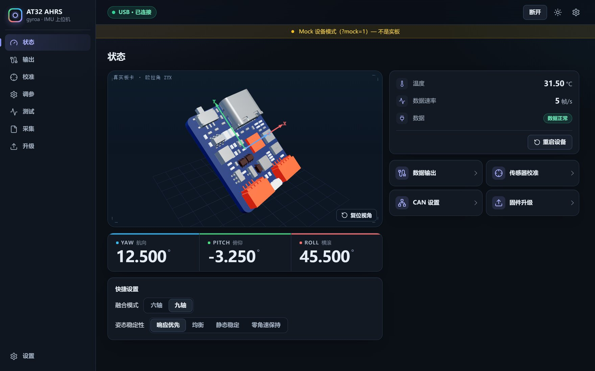

# AT32F423 AHRS

AT32F423KCU7-4（150 MHz，内部 HICK 起振）+ LSM6DSV + IST8310 姿态参考系统。
仓库包含 APP 固件、配套 Bootloader 与网页上位机 gyroa 的源码，当前源码应用版本 `20261025a`。

## 在线试用

上位机已部署到 GitHub Pages，浏览器直接打开，无需安装任何东西：

**<https://mathonix.github.io/AT32F423_LSM6DSV/>**

- 桌面版 Chrome / Edge 可通过 Web Serial 直连板卡（板载 USB CDC，2 Mbaud）
- 没有硬件也能看：网址后加 `?mock=1` 进入演示模式，页面顶部会标注「Mock 设备模式」
- 另有 Cloudflare 镜像 <https://gyroa.233688.xyz/>

上位机源码见 [upper/gyroa](upper/gyroa/README.md)（Node.js ≥ 22.12.0）。



## 固件能力

- **融合算法**：VQF / EKF / ESKF 可切换，六轴 / 九轴可切换；ESKF 采用单套三维姿态误差状态
- **节拍**：陀螺采样 8 kHz，姿态生成 1 kHz；ESKF 预测 8 kHz、协方差传播 2 kHz、加速度输入 2 kHz、重力观测标称 500 Hz
- **采集**：SPI1 DMA 读取 LSM6DSV，60 s 实测 CPU 约 76.10%，采集计数闭合
- **接口**：USB CDC、UART（2 Mbaud）、CAN2，统一 `AA 55 | msg | len | seq | payload | CRC16` 帧
- **存储**：配置 / 校准区独立于 APP，升级只写 APP，不覆盖 Bootloader 与配置区
- **校准**：加计六面、陀螺零偏、温度零偏学习、磁椭球；支持后台自动保存

已知限制见 [SPI DMA 实板短测与已知问题](docs/SPI_DMA_BOARD_TEST_20261023.md)：20 秒 USB 序号存在缺失、自启动 1 次姿态超龄，判定为限定范围 CONDITIONAL PASS。

## 目录

| 目录 | 内容 |
| --- | --- |
| `src/` `inc/` `linker/` | APP 固件源码 |
| `bootloader/` | 配套 Bootloader，[说明](bootloader/README.md) |
| `upper/gyroa/` | 网页上位机，[说明](upper/gyroa/README.md) |
| `LICENSES/` | 第三方许可证 |

本仓库只发布固件、配套 Bootloader、上位机源码与许可证；采集数据、内部文档与本机工具不在发布范围内。

## 构建

需要 GNU Arm Embedded Toolchain 与 GNU Make（Windows 用 `mingw32-make`），工具链加入 PATH。

```sh
make -B DEBUG_BUILD=0 SIX_AXIS=0 all   # 九轴能力，运行时可切六轴
make -B DEBUG_BUILD=0 SIX_AXIS=1 all   # 强制六轴
make -C bootloader -B all              # 配套 Bootloader
```

APP 输出在 `build/lsm6dsv_spi_test/release-9axis/` 或 `release-6axis/`，BL 输出在 `bootloader/build/`，生成 `.bin`、`.hex` 与 `.elf`。

## 烧录

| 区域 | 地址 |
| --- | --- |
| Bootloader | `0x08000000` ~ `0x08007FFF` |
| APP | `0x08008000` ~ `0x0803BFFF` |
| 配置 / 校准 | `0x0803C000` ~ `0x0803FFFF` |

首次安装须用 SWD 同时更新 BL 与 APP；之后的升级走 USB CDC / UART / 网页，只写 APP。

## 文档

- [中文使用指南](docs/使用指南.md)（含单板性能指标摘要，WS2812 灯语见文末，适用版本以文首声明为准）
- [使用说明书 PDF](output/pdf/AT32_AHRS_使用说明书_20261024c.pdf)
- [SPI DMA 实板短测与已知问题](docs/SPI_DMA_BOARD_TEST_20261023.md)
- [上位机说明](upper/gyroa/README.md) · [Bootloader 说明](bootloader/README.md)

## 许可

第三方许可证见 `LICENSES/` 与上位机 [`src/public/THIRD-PARTY-NOTICES.txt`](upper/gyroa/src/public/THIRD-PARTY-NOTICES.txt)。
